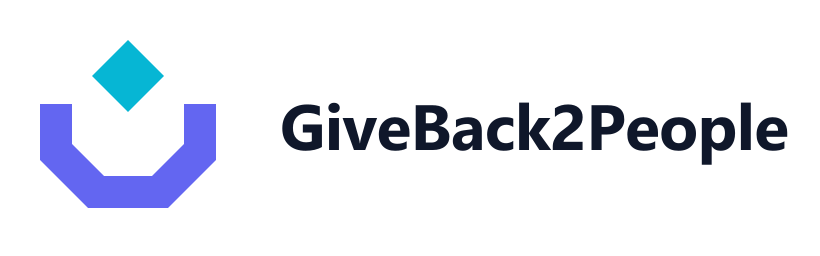

  <picture>
    <source media="(prefers-color-scheme: dark)" srcset="https://raw.githubusercontent.com/GiveBack2People/.github/main/profile/horizontal-color-dark.svg">
    <source media="(prefers-color-scheme: light)" srcset="https://raw.githubusercontent.com/GiveBack2People/.github/main/profile/horizontal-color-light.svg">
    
  </picture>

  
<strong>Open knowledge. Shared forward.</strong>

  
Open-source tools, curated creative resources, and practical knowledge built to pay it forward.

  

    
    
    
  

 

### About GiveBack2People

GiveBack2People is a community initiative dedicated to curating and building high-value open-source tools, design collections, and developer resources. Everything we produce is completely free, open source, and built to support creators, designers, and engineers worldwide.

* 🌐 **Showcase & Project Directory:** [giveback2people.github.io](https://giveback2people.github.io)
* 📦 **Public Repositories:** [Browse All Repositories](https://github.com/orgs/GiveBack2People/repositories?q=sort%3Astargazers-desc)
* 🤝 **Contributing:** All projects welcome community suggestions, issues, and pull requests.
